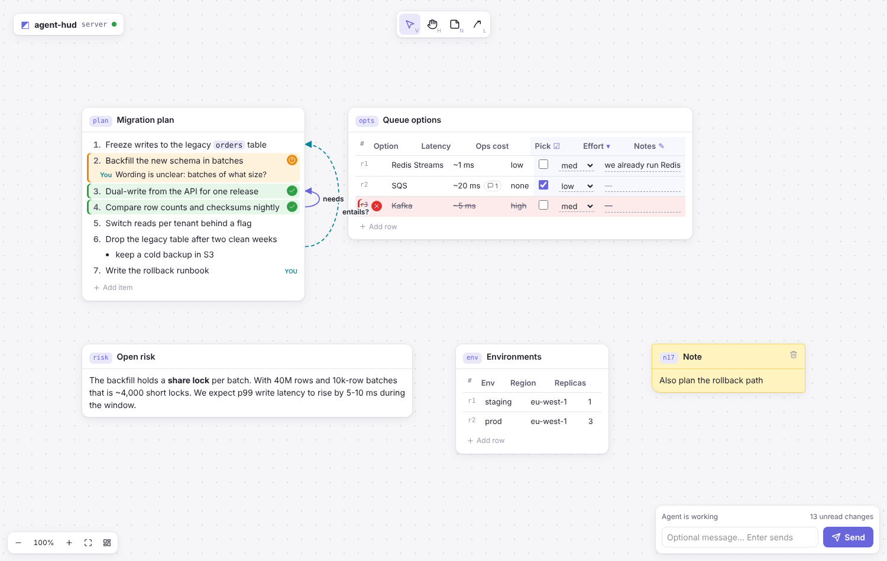

# agent-hud

A shared browser canvas for Claude Code. The agent puts plans, options and tables on the
canvas. You approve, reject or question each item, comment, edit, draw arrows and fill in
tables. Then you press **Send**, and the agent reads one short line per item you touched.



A chat reply such as "I like 3 and 4, 2 is unclear, and does 6 entail 1?" becomes this
read result:

```
plan.3 approve
plan.4 approve
plan.2 question; "Wording is unclear: batches of what size?"
link l14 plan.6 -> plan.1 "entails?" by user
opts.r2.pick = yes
submit "Mostly fine; fix 2 and check 6 vs 1"
```

## Install

Requires [uv](https://docs.astral.sh/uv/) on `PATH`. Node is not needed: the UI build is part
of the Python package.

```text
/plugin marketplace add implement0867/agent-hud
/plugin install agent-hud@agent-hud
```

The first start downloads the Python dependencies (a few seconds). If your network is slow and
the server does not start, run `uv sync --project <plugin dir>/server` one time, or raise
`MCP_TIMEOUT`.

To try a local checkout without installing: `claude --plugin-dir /path/to/agent-hud`.

## Use

- Ask for it: "put the plan on the canvas". The `canvas` skill also starts the loop when a
  reply needs a verdict per item.
- `/agent-hud:canvas` opens the canvas and reads what you left there.
- The first write opens the canvas in your browser. A blocking `read` shows "Agent is waiting
  for your review" on the page until you press Send.

| On the canvas | Action |
|---|---|
| Hover an item, row, cell or card title | approve, reject, question, comment, remove |
| Double-click text | edit it (Enter saves, Shift+Enter adds a line, Esc cancels) |
| `N`, or double-click empty space | sticky note for the agent |
| `L`, then click two parts | arrow, with optional text |
| `T` | tidy: re-flow cards so none overlap |
| Drag a card title | move; drag the right edge to resize |
| Drag empty space, `Space`+drag, `H` | pan |
| Ctrl/⌘ + scroll, `+` `-`, Ctrl+0, `!` | zoom, reset, fit all |
| Delete | delete your selected note or arrow |

## MCP tools

Two tools keep the definitions small (about 4.2 KB in total, examples and patterns removed).
Results are plain text, not JSON.

### `write(ops)`

Ops run in order, all or nothing. A failed batch changes nothing and names the failing op.

| Op | Fields | Effect |
|---|---|---|
| `put` | `id`, `md`, `title?`, `kind?` | Create or replace a card from markdown |
| `set` | `at`, `value` | Replace the text of an item, row (`a \| b`), cell or text card |
| `insert` | `at`, `value` | `plan.3` inserts before item 3; `plan` appends |
| `remove` | `at` | `plan` removes the card; `plan.3` one item; `opts.r2` one row |
| `reply` | `at`, `text` | Agent comment, for example an answer to a question |
| `link` | `src`, `dst`, `text?`, `id?` | Arrow between two parts |
| `clear` | | Remove every card |

`put` infers the card from the markdown (parsed with markdown-it-py, CommonMark plus GFM
tables):

| Markdown | Card |
|---|---|
| one list | list; items are `plan.1`, `plan.2`, … |
| one table | table; rows `t.r1`, cells `t.r1.price`, columns `t.price` |
| a table with `{check}`, `{text}`, `{number}` or `{a,b,c}` in header cells | interactive table; the user fills those columns |
| anything else | markdown text |

A leading heading becomes the title. Column keys are the header text in lower snake case.
A re-`put` keeps the anchors and feedback of items whose text did not change, keeps user
input in interactive columns, and marks feedback on changed items as `revised`.

### `read(wait=0, show=None)`

Returns the user's changes since the last read, one line per part, and then advances.

| Line | Meaning |
|---|---|
| `plan.3 approve` | verdict: `approve`, `reject`, `question`, `cleared reaction` |
| `plan.2 question; "text"` | verdict plus new comments |
| `plan.5 = "new text"` | the user edited the part |
| `opts.r2.pick = yes` | the user filled a cell |
| `plan.7 added "text"` / `plan.4 removed "text"` | the user added or removed an item or row |
| `note n4 "text"` | the user added a sticky note |
| `link l5 plan.6 -> plan.1 "text" by user` | the user drew an arrow |
| `submit "message"` | the user pressed Send |

`wait=N` blocks up to N seconds until the user presses Send. While it waits, the server sends
progress notifications so the client does not end the call as idle. If no canvas tab connects
within 15 seconds, it returns at once and says so. `show=["plan"]` or `["*"]` adds the full
current state of those cards with their feedback.

## How it works

```
Claude Code ──stdio (MCP)──▶ agent-hud (Python, FastMCP)
                              ├── Board: elements, feedback, user change log, agent cursor
                              └── FastAPI on 127.0.0.1:7676 ──websocket──▶ canvas (React)
```

- The board is the single source of truth. The page sends user actions; the server applies
  them and pushes the changed elements to every open tab.
- Each part of a card has a stable *anchor* key, so feedback stays attached when items move.
  The agent sees positional *labels* (`plan.3`), which are short and easy to write.
- The page is served from loopback only. The server checks the `Host` header and accepts
  websockets only from its own origin.

## Primitives

Each step adds to the one before it:

1. **Text**: markdown block.
2. **List**: numbered or bulleted; every item is an anchor.
3. **Table**: every row, column and cell is an anchor.
4. **Interactive table**: a table whose typed columns get editors (checkbox, choice, number,
   text). It shares the table model (`TableBase`) and view (`TableBody`); only column types,
   cell coercion and cell editors are new.

Add a primitive:

1. Python: subclass `BoxBase` (or `TableBase`) in `server/src/agent_hud/primitives/`, with a
   `kind` literal and the anchor, mutation and `render` hooks. Add it to `Box` and `Element` in
   `primitives/__init__.py`, and to `build_box` if markdown should infer it.
2. UI: add its Zod schema to the `Element` union in `ui/src/protocol/schema.ts` and a case to
   `ui/src/primitives/Body.tsx`. Wrap each addressable part in `<Anchor>`; reactions, comments
   and arrows then work with no more code.
3. Run `make fixtures` and commit `protocol/fixtures/server.json`. Both test suites parse the
   shared fixtures, so a schema mismatch between Pydantic and Zod fails CI.

TypeScript's exhaustive `switch` and the discriminated unions on both sides refuse to build
until every place handles the new kind.

## Configuration

Every setting is a flag (`agent-hud --help`) and an environment variable.

| Variable | Default | Meaning |
|---|---|---|
| `AGENT_HUD_PORT` | `7676` | Preferred port; a free port is used when it is busy |
| `AGENT_HUD_HOST` | `127.0.0.1` | Interface to bind |
| `AGENT_HUD_OPEN_BROWSER` | `true` | Open the canvas when no tab shows it |
| `AGENT_HUD_MAX_WAIT` | `1800` | Upper bound in seconds for one blocking read |
| `AGENT_HUD_STATE_FILE` | none | JSON file that keeps the board across restarts |
| `AGENT_HUD_EXTRA_ORIGINS` | `[]` | More page origins allowed on the websocket |
| `AGENT_HUD_STATIC_DIR` | packaged UI | Directory of the UI build to serve |

## Development

```text
.claude-plugin/   plugin and marketplace manifests; plugin.json also starts the server (uv run)
skills/ commands/ agent guidance and the /agent-hud:canvas command
server/           Python: FastMCP tools, board, FastAPI app, primitives (uv, ruff, basedpyright, pytest)
ui/               React + Vite + strict TypeScript + Zod + ESLint (typescript-eslint strictTypeChecked)
protocol/         JSON fixtures that both test suites validate
```

| Command | Does |
|---|---|
| `make check` | ruff, basedpyright, pytest; tsc, eslint, prettier, vitest |
| `make build` | build the UI into `server/src/agent_hud/static` (commit the result) |
| `make demo` | canvas with sample cards and the `/debug` API, no MCP |
| `make dev` | Vite dev server with hot reload, proxied to a demo canvas |
| `make fixtures` | regenerate the shared protocol fixture |

In `--mode serve`, `POST /debug/write` (a JSON list of ops) and `GET /debug/read?show=*`
drive the agent side over HTTP. Both need the header `X-Agent-Hud: 1`.
